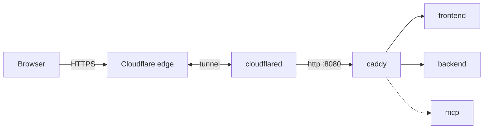

# CISO Assistant

An altered setup of [ciso-assistant-community](https://github.com/intuitem/ciso-assistant-community)
that is installable with a **single `docker-compose.yml`** (also usable as a Dockhand stack).

## What is different from upstream

- Docker **named volumes** instead of the `./db:/code/db` bind mount.
- No `docker-compose.sh` / `docker-compose.ps1` required.
- An `init` one-shot service prepares the database volume (permissions, Django secret key).
- The initial superuser is created automatically from environment variables.
- Minor tweaks: configurable URL, YAML anchors, simplified healthcheck.

See [CHANGES.md](./CHANGES.md) for the full report of what was changed and why.

## Former issue (fixed)

The backend image has no `/code/db` folder, so a fresh volume mounted there is owned by root while the
containers run as user `1001`. SQLite could not create its database, `huey` would not start and the
backend shut down. The `init` service now creates the files and fixes ownership before the backend starts.

## Requirements

- Docker with Docker Compose v2 (`docker compose`), internet access to pull the images.
- Ports `8443` (web) and `6333` (qdrant) free on `127.0.0.1`.

## Usage

### 1. (Optional) Configure

Create a `.env` file (or copy `.env.dist` to `.env`) next to `docker-compose.yml` (or set these as Dockhand stack variables):

```env
DJANGO_SUPERUSER_EMAIL=you@example.com
DJANGO_SUPERUSER_PASSWORD=a-strong-password
CISO_ASSISTANT_URL=https://localhost:8443
```

Defaults: `admin@example.com` / `ChangeMe-123!` / `https://localhost:8443`. Change the password before real use.

### 2. Start

```powershell
docker compose up -d
```

The first start takes a few minutes (image pull, database migrations, library import). Follow it with
`docker compose logs -f backend`. The stack is ready when `docker compose ps` shows `backend` as `healthy`.

### 3. Open

<https://localhost:8443> and log in with the superuser. The certificate is issued by Caddy's internal CA,
so the browser shows a warning that you must accept for local use.

### Optional: MCP server

For external AI orchestrators (read-only, each caller uses its own personal access token):

```powershell
docker compose --profile mcp up -d
```

It is served at `https://localhost:8443/mcp`. If you change the URL/port, set `CA_MCP_ALLOWED_HOSTS`
(e.g. `myhost:8443`).

### Optional: Cloudflare Tunnel

Expose CISO Assistant on the internet without opening any port. A `cloudflared` container connects out to
Cloudflare, and Cloudflare forwards `https://ciso.example.com` to Caddy's internal plain-HTTP listener
(`http://caddy:8080`, not published on the host). TLS ends at Cloudflare.



**1. Create the tunnel** (Cloudflare Zero Trust dashboard -> Networks -> Tunnels -> Create a tunnel ->
Cloudflared). Copy the tunnel **token** (the long string after `--token`).

**2. Add a public hostname** to the tunnel:

| Field | Value |
| --- | --- |
| Subdomain / Domain | e.g. `ciso` / `example.com` |
| Service type | `HTTP` |
| Service URL | `caddy:8080` |

**3. Configure `.env`** (or Dockhand stack variables). Use your public hostname everywhere:

```env
CISO_ASSISTANT_URL=https://ciso.example.com
ALLOWED_HOSTS=backend,localhost,ciso.example.com
CLOUDFLARE_TUNNEL_TOKEN=<token from step 1>
# only if you also use the mcp profile:
CA_MCP_ALLOWED_HOSTS=ciso.example.com
```

`CISO_ASSISTANT_URL` is used for CSRF/CORS checks, login redirects and the frontend's API URL, so it must be the
public URL. `ALLOWED_HOSTS` must contain the public hostname, otherwise the backend rejects requests
(`DisallowedHost`).

**4. Start with the `tunnel` profile:**

```powershell
docker compose --profile tunnel up -d
# with MCP too (served at https://ciso.example.com/mcp):
docker compose --profile tunnel --profile mcp up -d
```

Check it with `docker compose logs cloudflared` (look for `Registered tunnel connection`), then open
`https://ciso.example.com`.

Notes:

- With `CISO_ASSISTANT_URL` set to the public URL, the local `https://localhost:8443` address no longer works
  as an app entry point (the frontend and CSRF checks expect the public origin). Switch back by unsetting the
  variables and restarting, or run a separate stack for local use.
- Only the public hostname you configured is routed; requests for other hostnames are rejected by the backend.
- The app is now on the internet. Use a strong superuser password, and consider protecting the hostname with
  **Cloudflare Access** (Zero Trust -> Access -> Applications), especially for `/mcp` and `/api`.
  Cloudflare Access on `/api` can break API clients and the MCP server; scope policies accordingly.
- Client IPs seen by the backend are the tunnel's internal IPs, not the visitors' IPs.
- Setting `CLOUDFLARE_TUNNEL_TOKEN` is only required when the `tunnel` profile is enabled. Treat the token
  as a secret and do not commit it.

### Dockhand

Create a new stack, paste the contents of `docker-compose.yml`, set the variables above in the stack's
environment, and deploy. To enable MCP or the tunnel, enable the `mcp` / `tunnel` compose profiles in the stack
settings (or deploy with `--profile mcp --profile tunnel`).

## Volumes

| Volume | Content |
| --- | --- |
| `ciso_db` | SQLite databases, task queue, Django secret key, attachments |
| `qdrant_data` | Vector database storage |
| `caddy_data` | Caddy internal CA / certificates |

## Maintenance

```powershell
docker compose pull; docker compose up -d     # update
docker compose logs -f backend huey           # logs
docker compose down                           # stop, keep data
docker compose down -v                        # stop and DELETE ALL DATA
```

Back up the database:

```powershell
docker run --rm -v <project>_ciso_db:/db -v ${PWD}:/backup busybox tar czf /backup/ciso_db.tgz -C /db .
```

(`<project>` is the compose project name, usually the folder name; check with `docker volume ls`.)

## Troubleshooting

- **`unable to open database file` / huey exits**: the `ciso_db` volume has wrong ownership. Run
  `docker compose up -d init` again, or recreate with `docker compose down -v`.
- **Tunnel: `cloudflared` restarts with "Provided Tunnel token is not valid"**: `CLOUDFLARE_TUNNEL_TOKEN` is
  empty or truncated; copy only the token, not the whole `cloudflared ... --token` command.
- **Tunnel: Cloudflare error 502/1033**: `cloudflared` is not connected (check its logs), or the public
  hostname's service URL is not `http://caddy:8080`.
- **Tunnel: "Invalid HTTP_HOST header" / `DisallowedHost` / `Cross-site POST form submissions are forbidden`**:
  `ALLOWED_HOSTS` or `CISO_ASSISTANT_URL` does not match the public hostname exactly (scheme `https`, no
  trailing slash). Recreate the containers after changing them (`docker compose up -d`).
- **Backend stays unhealthy**: check `docker compose logs backend`; first start can take 2 minutes or more.
- **Cannot log in**: the superuser is only created on first start with an empty database. Reset the
  password with `docker compose exec backend python manage.py changepassword you@example.com`.

## Resources

- <https://github.com/intuitem/ciso-assistant-community>
